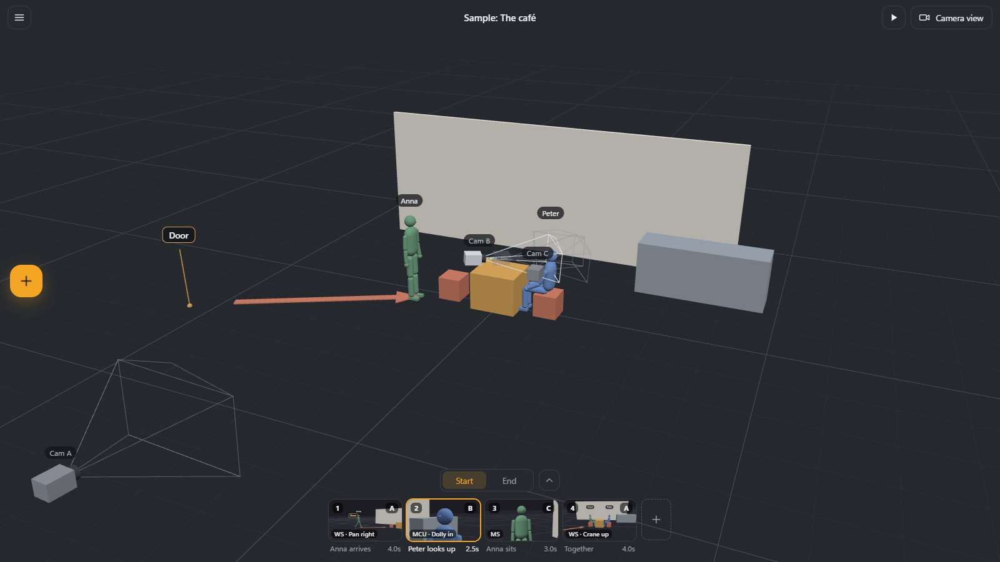
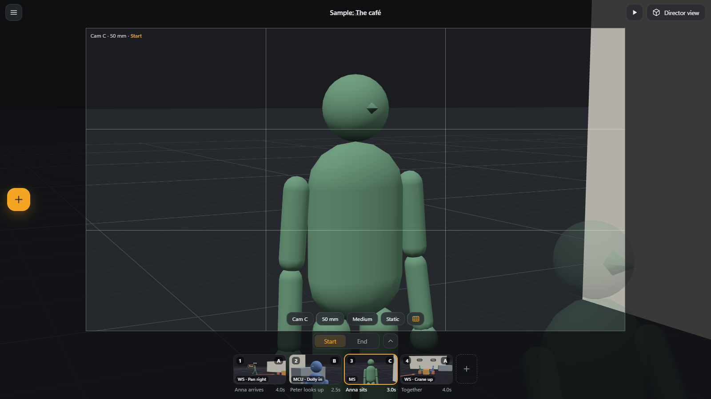
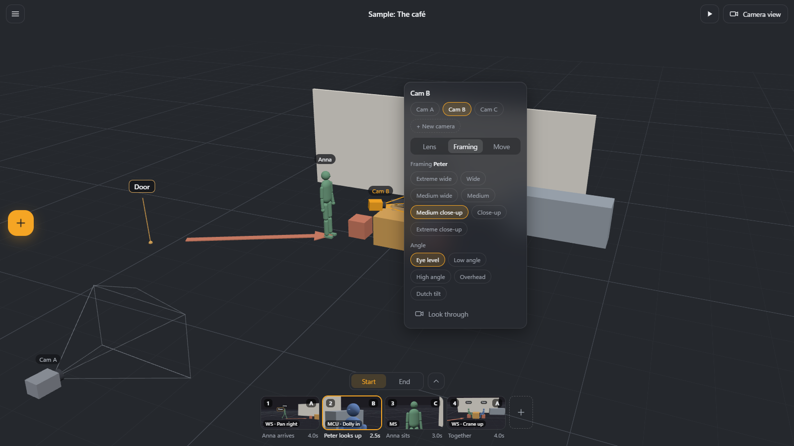
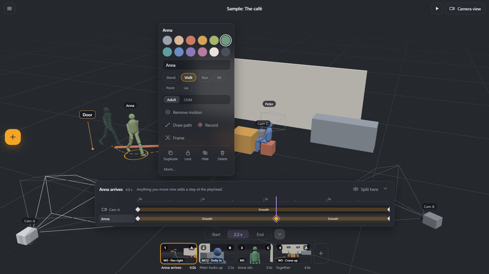
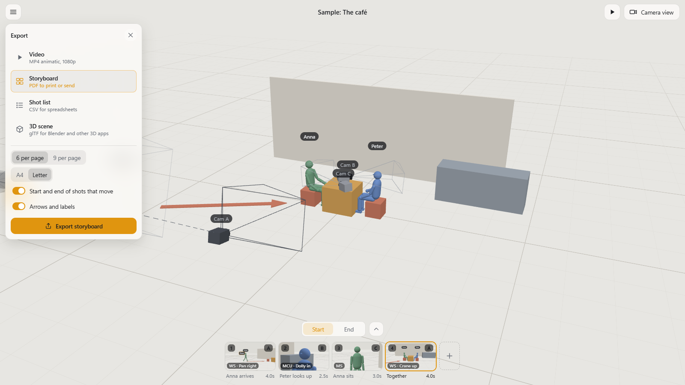

# ReEziser

A fast 3D sketchpad for films, music videos and scenes: block out a set with simple shapes and people, place cameras, split the action into shots, and play it back as an animatic.



It is a sketchpad, not Blender: the canvas is everything, there are only a few buttons on screen, and everything else appears where you need it. Things are named the way filmmakers talk: close-up, 50 mm, dolly in.

## What it does

- **People and props.** Posable mannequins (stand, walk, run, sit, point, lie) and simple shapes, moved by dragging them across the floor. No gizmos.
- **Cameras that speak film.** Several cameras with cuts between them, lenses from 14 to 135 mm, aspect ratios from 2.39:1 to 9:16, one-click shot types (wide to extreme close-up) and angles, and camera-move presets (pan, tilt, dolly, truck, orbit, crane, zoom).
- **Shots, not keyframes.** Each shot has a Start and an End; whatever changes in between animates smoothly, and the next shot carries on from where the last one ended.
- **Fast motion.** Draw a path on the floor and a person walks it, or perform the move live while the shot plays. A detailed timeline is there for steps in between and easing.
- **Music.** Add a track, see its waveform and beats under the shots, and snap cuts to the beat.
- **Export.** MP4 animatic with sound, storyboard PDF, CSV shot list, and a glTF scene for Blender with the whole film as an animation.
- **Windows desktop app.** Built with Tauri 2, with autosave, the `.reeziser` file type, a light theme and touch support for tablets. It also runs in a browser.

| | |
|---|---|
|  |  |
| **Camera view:** exactly what the lens sees, with frame guides and the camera tools under the frame. | **One-click framing:** pick a shot type and angle; the camera frames the person for you. |
|  |  |
| **Timeline:** steps in between, retiming, easing, and splitting a shot. | **Export** to video, storyboard PDF, shot list or a 3D scene. Light theme shown. |

The pictures show the sample scene that ships with the app (Menu → Open sample scene).

## Run

```sh
npm install
npm run dev        # http://localhost:5173
npm test           # unit tests (model, interpolation, lenses, undo)
npm run test:e2e   # browser smoke test (Playwright)
npm run build
npm run desktop        # desktop window (Tauri; needs Rust and the MSVC build tools)
npm run desktop:build  # installer: src-tauri/target/release/bundle/msi/*.msi
```

## Layout

| Path | What lives there |
|---|---|
| `src/model/` | Pure logic with no React: data types, interpolation, lenses, poses, shot/state rules, cameras, framing, camera moves, the 180° line, groups, timeline, paths and takes, beats, the sample scene, undo history, file format. Covered by unit tests. |
| `src/export/` | Video (MP4), storyboard (PDF), shot list (CSV) and 3D scene (glTF). The pure parts are covered by `export.test.ts`. |
| `src/audio/` | Decoding, waveform and playback of the soundtrack. |
| `src/store/` | Zustand store that connects the model to the UI (selection, current shot, Start/End, playback, undo). |
| `src/viewport/` | React Three Fiber scene: objects, mannequin, camera gizmo, gizmo-free drag, Camera-view controls, thumbnails. |
| `src/ui/` | The few on-screen controls: top bar, add palette, context panel, shot strip, camera frame, labels, menu. |
| `src/io/` | Save, open, export files and autosave, in the browser and in the desktop app. |
| `src-tauri/` | The Windows desktop app (Tauri 2) and its installer. |

## Controls

| | |
|---|---|
| Orbit / pan / zoom | Right drag / middle drag or Space + left drag / wheel |
| Move along the floor | Drag an object (Shift = no snapping, Ctrl = only along the line you started on) |
| Lift · Rotate · Scale | Alt + drag · R + drag (or Ctrl + wheel) · S + drag |
| Select more | Shift + click, or drag a rectangle on empty space |
| Focus · Reset view | F or double-click · Home |
| Axis lock | Hold Ctrl while dragging an object or a camera, or while panning/tilting in Camera view: the move keeps to the direction it started in |
| Camera view | Tab. In it: right drag = pan/tilt, wheel = dolly, middle drag = truck/pedestal, W A S D = walk, Q / E = down / up, Shift = faster (with nothing selected) |
| Shots | N new · ← → previous/next · drag a card to reorder · drag its right edge to change length |
| Play | Space (Shift + Space from the current shot) · L loops the current shot · Esc stops |
| Undo / Redo · Save | Ctrl + Z / Ctrl + Shift + Z (or Ctrl + Y) · Ctrl + S |
| Radial menu | Short right click on an object or camera |
| Group · Ungroup | Ctrl + G · Ctrl + Shift + G |
| Cameras | Select the camera: Lens · Framing (shot type, angle) · Move tabs. In Camera view the same tools are chips under the frame, plus frame guides |
| Arrow · Label | [+] → Arrow, then drag on the floor · [+] → Label |
| Export | Menu → Export… (Ctrl + E): video, storyboard PDF, shot list CSV, 3D scene (.glb for Blender, with the film as an animation) |
| Timeline | ˄ next to Start / End, or double-click a shot: drag the playhead into the shot and move things to add steps; drag a step to retime it, right-click to remove it; click a stretch to change how it moves; Split here |
| Draw a path | Select a person or object → Draw path, then draw on the floor. For the camera: camera panel → Move → Draw a camera path |
| Record a take | Select → ● Record, then press and drag: the shot plays while you hold |
| Touch | One finger: select and move. Two fingers: orbit and pinch (in Camera view: look around and walk). Two-finger tap: undo, three-finger tap: redo. Hold on an object: radial menu |
| Theme · Sample | Menu → Theme (Dark, Light, Windows) · Menu → Open sample scene |
| Music | Menu → Add music… Cards show the waveform and beats; shot edges snap to beats (Shift: free); drag the waveform to slide the music |
